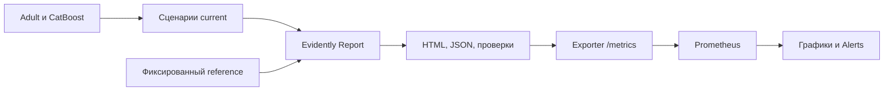

# Сценарий защиты: Evidently + Prometheus

Цель показа: модель CatBoost работает на Adult, Evidently обнаруживает изменения данных и различия между группами, Prometheus хранит реальные метрики и переводит алерт в Firing. Ориентир — 10–15 минут. Браузер открываешь самостоятельно; автоматизация использует только файлы и HTTP API.

## 1. Подготовить стенд

Если модель и сценарии уже созданы, достаточно из корня проекта:

```powershell
docker compose up --build -d
docker compose ps
```

Ожидается exporter healthy. Проверка `/health` означает работоспособность HTTP-сервера, а готовность данных проверяется метрикой `ml_monitoring_available == 1`. В Prometheus на странице `http://127.0.0.1:9090/targets` target `adult-monitoring` должен быть UP.

В чистом checkout, где ещё нет данных и модели, выполнить один раз:

```powershell
docker compose --profile init build
docker compose --profile init run --rm --no-deps init
docker compose --profile init run --rm --no-deps init python -m adult_monitoring scenarios --config configs/example.yaml
docker compose --profile init run --rm --no-deps init python -m adult_monitoring monitor --config configs/example.yaml --scenario all
docker compose up -d
```

Первый запуск требует интернета для Docker/PyPI/UCI. Init обучает модель и записывает новые артефакты: не выполняй его поверх работающей демонстрации. Все команды завершаются с кодом 0; при ошибке остановись и используй [runbook инцидентов](INCIDENT_RUNBOOK.md).

Для переключения сценариев объявить в PowerShell функцию:

```powershell
function Set-DemoScenario {
    param([string]$Scenario)
    $scenarioBody = @{ scenario = $Scenario } | ConvertTo-Json -Compress
    Invoke-RestMethod -Method Post -Uri http://127.0.0.1:8000/scenario -ContentType 'application/json' -Body $scenarioBody -TimeoutSec 120
}
Set-DemoScenario baseline
```

Ответ — `status: success` с нужным сценарием. Если получен 409, фоновый расчёт уже идёт: подожди 5 секунд и повтори ту же команду. После успешного POST подожди scrape/evaluation Prometheus: оба интервала равны 5 секундам.

## 2. Объяснить проект за минуту

«Это учебный пакетный мониторинг бинарной классификации дохода. Положительный класс — доход больше $50K. CatBoost обучен на train, validation использован для порога; reference и current не участвовали в обучении. Sex исключён из входов модели, но сохранён для аудита. Генератор изменяет current, Evidently пересчитывает метрики, экспортер отдаёт результат Prometheus».



За деталями обучения и ограничениями — [карточка модели](MODEL_CARD.md).

## 3. Baseline и исходный fairness

Открыть `reports/evidently/baseline/report.html`. Найти F1 >50K, размеры групп, selection rate, TPR, DPD и DI. Проверенные значения этой модели: F1 около 0.703191; Female selection rate около 0.0831, Male — 0.2579; DI около 0.3221.

Произнести: «Baseline означает отсутствие искусственного воздействия. Он уже не проходит абсолютные fairness-проверки DPD/DI. Хороший общий F1 и исключение sex из признаков не гарантируют равенства групп».

В `http://127.0.0.1:9090/query` выбрать отображение графика и вставить:

```promql
{__name__=~"ml_f1_score|ml_f1_threshold"}
```

Выбрать последние 15 минут. Порог F1 этой модели — 0.663487, получен на validation как F1 минус 0.05. Он не подбирается по текущему сценарию.

## 4. Дрейф возраста через Evidently

```powershell
Set-DemoScenario feature_drift
```

Открыть `reports/evidently/feature_drift/report.html`, найти блок age (при необходимости раскрыть его) и распределения current/reference. Для age +5 лет проверенный score около 0.387787 при пороге 0.1; тест FAIL означает обнаруженный дрейф. Это нормированное расстояние Wasserstein, не p-value.

Показать в Prometheus. В блоках с несколькими запросами выполнять их по одному, а не вставлять весь блок как одно выражение:

```promql
ml_feature_drift_score{feature="age"}
ml_feature_drift_detected{feature="age"}
```

На странице `http://127.0.0.1:9090/alerts` правило FeatureDriftDetected достигает Firing с меткой feature=age. Правило требует 15 секунд непрерывного выполнения условия плюс ожидание scrape/evaluation.

Объяснение: дрейфует 1/13 признаков, поэтому общий порог 50% не пересечён. Отдельный age-сигнал сохраняется. F1 при +5 годах немного вырос: дрейф не равен обязательному ухудшению качества.

## 5. Изменение общего баланса классов

```powershell
Set-DemoScenario target_drift
```

Открыть `reports/evidently/target_drift/report.html`, найти Value drift for income. Доля настоящего >50K в current стала около 60% против около 23.6% reference; Evidently обнаруживает drift. Метки не переписаны — выполнена повторная выборка исходных строк с сохранением row_id.

В Prometheus показать `ml_target_drift_detected`, при ожидании — TargetDriftDetected в Firing. В этом сценарии меняются и некоторые признаки вследствие отбора по классу.

Произнести: «Изменение баланса классов само по себе не доказывает дискриминацию. Следующий шаг проверяет конкретную группу и её fairness-метрики».

## 6. Смещение одной группы и fairness именно через Evidently

```powershell
Set-DemoScenario fairness_shift
```

Открыть два отчёта:

- `reports/evidently/fairness_shift/female_target_report.html` — распределение income только внутри Female, Jensen–Shannon drift и FAIL.
- `reports/evidently/fairness_shift/report.html` — пользовательские Evidently metrics DPD/DI/TPR и их pass/fail проверки рядом с reference.

У Female теперь 82 положительные метки из 2721 строки (около 3%); исходные 5406 Male сохранены. DI этой модели снизился с baseline 0.3221 до 0.1368. Общая проверка income может остаться зелёной — это причина отдельного группового контроля.

В Prometheus показать:

```promql
ml_female_target_drift_detected
ml_group_selection_rate
ml_disparate_impact
ml_disparate_impact / ml_disparate_impact_reference
```

Правила FemaleTargetDriftDetected и FairnessDeteriorated показывают групповой сдвиг и ухудшение относительно фиксированного reference. Отношение DI к reference сравнивается с учебным порогом 0.8; это отдельная проверка, отличная от абсолютного DI >= 0.8.

## 7. Падение F1, Pending и Firing

```powershell
Set-DemoScenario fairness_defect
```

Открыть `reports/evidently/fairness_defect/report.html`. Произнести: «Здесь специально введён синтетический дефект постобработки: вероятность Female умножена на 0.05. Исходные model_probability_gt50k и model_prediction сохранены; effective prediction и флаг synthetic_postprocessing_applied показывают вмешательство. Это не естественное поведение CatBoost».

F1 падает примерно до 0.644947, ниже 0.663487; Evidently F1 test и fairness-проверки FAIL. В Prometheus оставить график F1/порога и страницу Alerts. Наблюдать ModelF1Low: сначала Pending, затем Firing. Правило требует непрерывного нарушения 15 секунд; scrape/evaluation добавляют задержку.

Запрос для независимого подтверждения:

```promql
ALERTS{alertname="ModelF1Low",alertstate=~"pending|firing"}
```

Снимок Firing делай до переключения на recovery. Автоматический verify_stack.py сам быстро восстанавливает recovery, поэтому для ручных кадров используй именно последовательные POST из этого сценария.

## 8. Восстановление

```powershell
Set-DemoScenario recovery
```

F1 возвращается примерно к 0.703191. После очередного scrape/evaluation ModelF1Low становится Inactive. FairnessDeteriorated также снимается; FairnessThresholdViolated остаётся, потому что исходный baseline уже нарушает абсолютные DPD/DI пороги.

## Автоматическое доказательство и файлы к сдаче

Для проверки без браузера:

```powershell
docker compose exec -T exporter python scripts/verify_stack.py --prometheus http://prometheus:9090
docker compose exec -T exporter python scripts/plot_prometheus_evidence.py
```

Ожидаются код 0, `result: passed` в `reports/prometheus_demo/evidence.json` и график `f1.png`. PNG построен по API-данным; он не является снимком интерфейса Prometheus.

Предлагаемые кадры, которые снимаешь самостоятельно:

| Файл | Что должно быть видно |
| --- | --- |
| 01_evidently_age.png | Распределения age, score, threshold, FAIL |
| 02_evidently_target.png | Сдвиг общего баланса income и FAIL |
| 03_evidently_female_target.png | Баланс income внутри Female и FAIL |
| 04_evidently_fairness.png | Current/reference DI, DPD или TPR, проверки Evidently |
| 05_prometheus_f1.png | График F1 и порога с падением и восстановлением |
| 06_prometheus_firing.png | ModelF1Low в Firing, фактический F1 в аннотации |
| 07_prometheus_recovery.png | ModelF1Low Inactive после recovery |

Кадр Pending полезен дополнительно. Пустые файлы и вымышленные снимки не создаются. К сдаче приложи ссылку на репозиторий, реальные кадры, нужные HTML и evidence.json. Генерируемые данные/модель/отчёты исключены из Git и воспроизводятся командами выше.

Краткие ответы на вопросы: F1 требует настоящих меток (в симуляции доступны сразу); sex исключён, но прокси остаются; дрейф не обязан снижать F1; повторная выборка не создаёт независимых людей; Firing — реальное состояние Prometheus, доставка уведомлений через Alertmanager в этот проект не включена.
